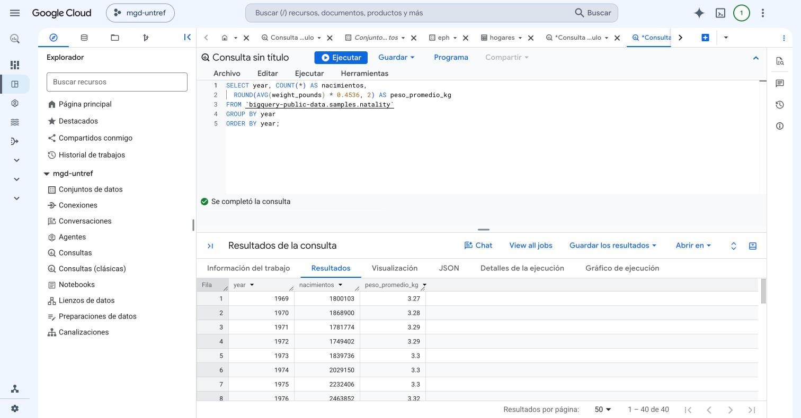
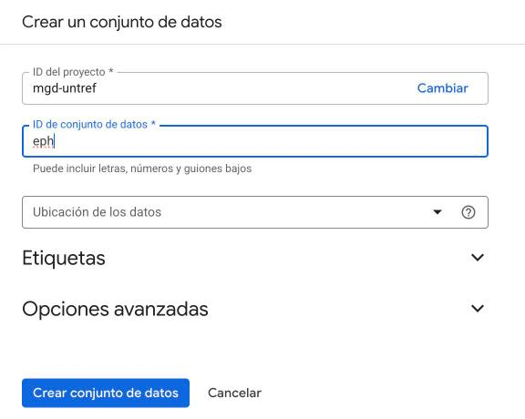
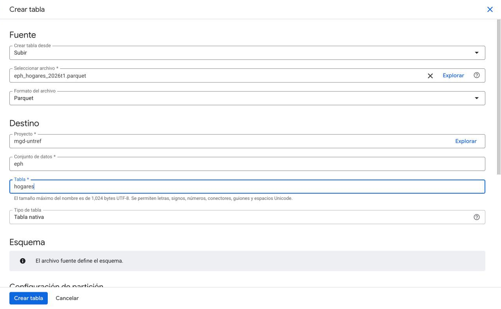
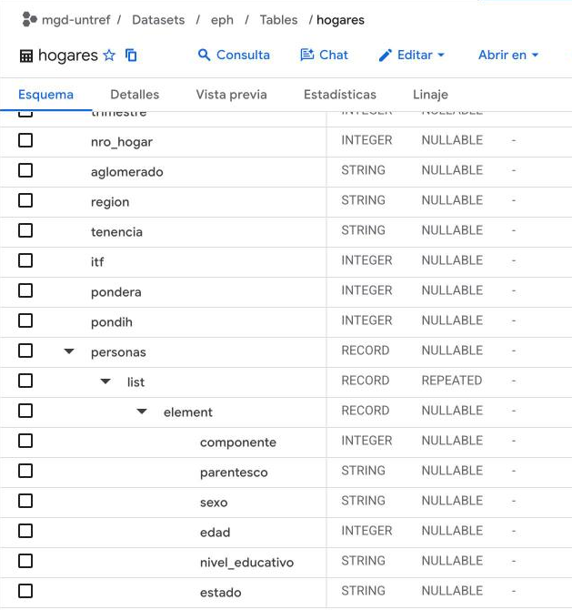
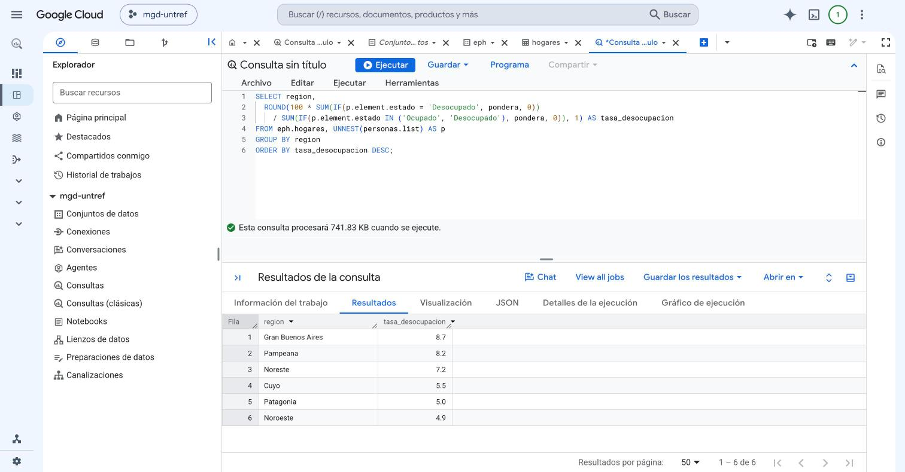

# Un data warehouse en la nube con BigQuery

BigQuery es el data warehouse de Google Cloud. Como DuckDB, guarda los datos por columnas y se consulta con SQL, pero corre en los servidores de Google: no hay nada que instalar, se usa desde el navegador y cada consulta se reparte entre muchas máquinas. Se paga por los datos que se guardan y por los que lee cada consulta.

Para el curso alcanza con su modo gratuito, el **sandbox**: se activa con una cuenta de Google, no pide tarjeta de crédito y permite guardar hasta 10 GB y consultar hasta 1 TB por mes. Las tablas que se cargan vencen a los 60 días.

## 1. Activar el sandbox

1. Entrar a la [consola de BigQuery](https://console.cloud.google.com/bigquery) con una cuenta de Google.
2. La primera vez, la consola pide elegir el país y aceptar las condiciones del servicio.
3. Crear un proyecto, que agrupa todo lo que hagamos en Google Cloud. Si la consola no lo ofrece directamente, se hace desde el selector de proyectos, arriba a la izquierda, con el botón **Proyecto nuevo**. Escribir un nombre, por ejemplo `mgd-untref`, dejar **Sin organización** y hacer clic en **Crear**.

Mientras el proyecto no tenga una cuenta de facturación, queda en el sandbox. Si la cuenta de Google ya tiene una, por ejemplo porque se usó Google Cloud antes, el proyecto nuevo puede quedar asociado a ella: tampoco se paga nada mientras se respeten los mismos límites gratuitos.

## 2. Consultar un dataset público

BigQuery trae datasets públicos para practicar. Uno de los clásicos es `natality`, con los nacimientos registrados en Estados Unidos entre 1969 y 2008: 137.826.763 filas.

1. En la página principal de BigQuery Studio, hacer clic en **Consulta en SQL**.
2. Escribir esta consulta, que cuenta los nacimientos de cada año y calcula el peso promedio al nacer (la tabla lo guarda en libras, por eso se multiplica por 0,4536):

```sql
SELECT year, COUNT(*) AS nacimientos,
  ROUND(AVG(weight_pounds) * 0.4536, 2) AS peso_promedio_kg
FROM `bigquery-public-data.samples.natality`
GROUP BY year
ORDER BY year;
```

3. Antes de ejecutarla, mirar el mensaje que aparece abajo del editor: **Esta consulta procesará 2.05 GB cuando se ejecute**. Es lo que se descuenta del terabyte gratuito del mes.
4. Hacer clic en **Ejecutar**.



BigQuery resume casi 138 millones de filas en menos de un segundo.

Cada consulta lee solo las columnas que usa. Si en el editor se escribe `SELECT * FROM` y el nombre de la tabla, sin ejecutarla, el mensaje cambia a **21.94 GB**: más de diez veces más datos, porque leería todas las columnas. Por eso en BigQuery conviene elegir las columnas y evitar `SELECT *`. Es la misma idea de los formatos por columnas, como Parquet.

## 3. Cargar la EPH

Cargamos los hogares de la EPH desde un archivo Parquet, el formato que trabajamos con DuckDB y R.

1. Descargar el archivo [eph_hogares_2026t1.parquet](../data/eph_hogares_2026t1.parquet) con el botón *Download raw file*. Tiene los mismos datos que el JSON que usamos con MongoDB y DuckDB, en menos de 0,5 MB.
2. Crear un conjunto de datos, que agrupa tablas como un esquema de PostgreSQL. En el **Explorador**, debajo del proyecto, hacer clic en **Conjuntos de datos** y después en **Crear un conjunto de datos**. Escribir `eph` en **ID de conjunto de datos** y hacer clic en **Crear conjunto de datos**.



3. Abrir el conjunto de datos `eph` y hacer clic en **Crear tabla**.
4. En **Crear tabla desde**, elegir **Subir**. En **Seleccionar archivo**, hacer clic en **Explorar** y elegir el archivo descargado: el formato cambia solo a **Parquet**.
5. En **Tabla**, escribir `hogares` y hacer clic en **Crear tabla**.



No hace falta definir las columnas. Como avisa el formulario, el archivo fuente define el esquema: Parquet guarda adentro el nombre y el tipo de cada columna.

## 4. La consulta de DuckDB, en BigQuery

En una consulta nueva, escribir la misma consulta de la guía de DuckDB y hacer clic en **Ejecutar**:

```sql
SELECT region, COUNT(*) AS hogares
FROM eph.hogares
GROUP BY region
ORDER BY hogares DESC;
```

El resultado es el mismo:

| region | hogares |
|---|---:|
| Pampeana | 5084 |
| Noroeste | 2986 |
| Gran Buenos Aires | 2415 |
| Patagonia | 2042 |
| Noreste | 1508 |
| Cuyo | 1412 |

Esta consulta procesa apenas 167 KB, porque solo lee la columna `region`.

## 5. Las personas de cada hogar

La tabla conserva la lista de personas de cada hogar. En la pestaña **Esquema** de la tabla se ve cómo la guardó BigQuery: el campo `personas` tiene adentro una lista, `list`, y cada persona está en `element`, con su sexo, edad, nivel educativo y estado de actividad. Son los nombres con los que Parquet guarda las listas.



Para trabajar con las personas, `UNNEST` despliega la lista: cada persona queda en una fila, junto con los datos de su hogar, como `$unwind` en MongoDB o `unnest()` en R. Esta consulta calcula la tasa de desocupación de cada región con el ponderador de la EPH:

```sql
SELECT region,
  ROUND(100 * SUM(IF(p.element.estado = 'Desocupado', pondera, 0))
    / SUM(IF(p.element.estado IN ('Ocupado', 'Desocupado'), pondera, 0)), 1) AS tasa_desocupacion
FROM eph.hogares, UNNEST(personas.list) AS p
GROUP BY region
ORDER BY tasa_desocupacion DESC;
```



Gran Buenos Aires da 8,7%, el mismo resultado que obtuvimos con SQL en PostgreSQL, con MongoDB y con R.

Todas las consultas quedan registradas en **Historial de trabajos**, en el Explorador, con los datos que procesó cada una.

_Última actualización: noviembre de 2026._
