# Un lakehouse con Databricks

Databricks es una plataforma para guardar, procesar y analizar datos en la nube. Es el ejemplo más conocido de **lakehouse**: guarda los datos en archivos abiertos, como Parquet, y les suma lo que da un data warehouse: tablas con nombre, tipos, transacciones e historial.

Para el curso alcanza con **Free Edition**, la versión gratuita para aprender. En esta guía cargamos los viajes en Ecobici de 2025, más de 3 millones, en un lakehouse con tres capas. Después armamos un modelo estrella y lo consultamos con SQL, un gráfico y un tablero.

## 1. Cómo funciona

Databricks se entiende con cuatro piezas, una arriba de la otra:

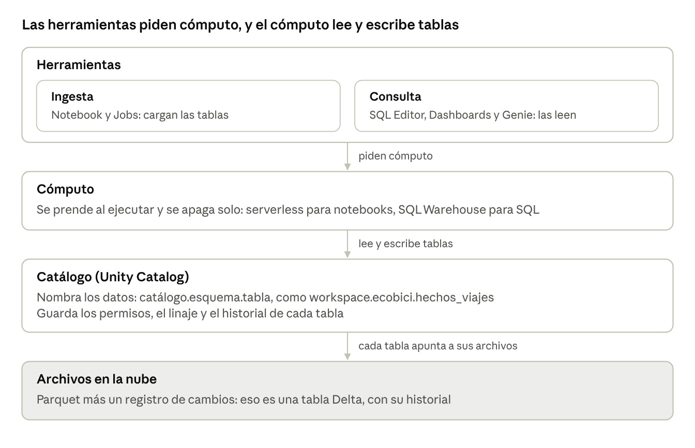

1. **Los datos son archivos.** Cada tabla es un conjunto de archivos Parquet guardados en la nube, más un registro de cambios. Eso se llama **tabla Delta**, y por eso cada tabla tiene historial.
2. **El catálogo les pone nombre.** Unity Catalog ordena todo en `catálogo.esquema.tabla`, como `base.esquema.tabla` en PostgreSQL. La tabla de hechos de esta guía es `workspace.ecobici.hechos_viajes`.
3. **El cómputo se prende cuando hace falta.** Al ejecutar algo, Databricks prende una computadora y la apaga después. Las notebooks usan cómputo **serverless**; el editor SQL y los tableros usan un **SQL Warehouse**.
4. **Las herramientas trabajan arriba de todo eso.** Notebooks, editor SQL, tableros y Genie leen o escriben las tablas del catálogo usando el cómputo.

El trabajo tiene dos momentos separados, y la guía también:

- **La ingesta:** una notebook baja los datos y arma las tablas. Se escribe una vez y se puede volver a ejecutar cuando lleguen datos nuevos.
- **La consulta:** sobre las tablas ya armadas, con el editor SQL, el catálogo y un tablero. No hace falta Python.

Casi todo tiene un equivalente en lo que ya usamos:

| En el curso | En Databricks |
| --- | --- |
| `base.esquema.tabla` en PostgreSQL | `catálogo.esquema.tabla` |
| El panel de objetos de pgAdmin | **Catalog** |
| Una notebook de Colab | **Notebook**, que corre en el cómputo de Databricks |
| La consola de BigQuery | **SQL Editor** |
| Un archivo Parquet | Una tabla Delta: Parquet más su historial |
| Un tablero de Power BI | **Dashboards** |

## 2. Lo que hay en la pantalla

La barra lateral muestra todo lo que ofrece Databricks. Es mucho, pero en esta guía usamos cinco cosas: **Workspace**, **Catalog**, una notebook, el **SQL Editor** y **Dashboards**.

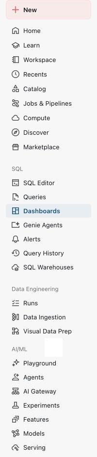

| Componente | Para qué sirve | En esta guía |
| --- | --- | --- |
| **Workspace** | Carpetas con notebooks, consultas y tableros, como un Drive | Sí |
| **Catalog** | Las tablas y los volúmenes, con su historial, linaje y permisos | Sí |
| **Compute** | Las computadoras que ejecutan el trabajo; en Free Edition son serverless | Sin configurarlo |
| **Jobs & Pipelines** | Ejecutar notebooks solas, por ejemplo todas las noches | No |
| **SQL Editor** y **Queries** | Escribir, ejecutar y guardar consultas SQL, con gráficos | Sí |
| **Dashboards** | Tableros con gráficos armados desde consultas | Sí |
| **Genie Agents** | Preguntas en castellano sobre las tablas, que Genie traduce a SQL | No |
| **Alerts** y **Query History** | Avisos cuando una consulta cumple una condición, y consultas ya ejecutadas | No |
| **SQL Warehouses** | El cómputo para SQL | Sin configurarlo |
| **Data Ingestion** y **Visual Data Prep** | Traer datos de otros sistemas y prepararlos sin código | No |
| **Marketplace** y **Discover** | Datos de terceros y búsqueda de datos de la organización | No |
| **AI/ML** | Aprendizaje automático e inteligencia artificial generativa | No |

## 3. Crear la cuenta

1. Entrar a la página de [Databricks Free Edition](https://www.databricks.com/learn/free-edition) y hacer clic en el botón para registrarse.
2. Elegir **Continue with Google**, **Continue with Microsoft** o escribir un correo.
3. Databricks crea un espacio de trabajo y lo abre. Tarda unos segundos.

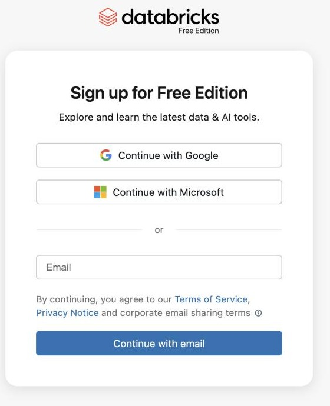

Free Edition no pide tarjeta de crédito y es para uso no comercial. Solo tiene cómputo serverless, acepta Python y SQL pero no R, y tiene una cuota de uso diaria: si se pasa, el cómputo se apaga hasta el día siguiente, pero los datos no se borran. El detalle está en la [página de limitaciones](https://docs.databricks.com/aws/en/getting-started/free-edition-limitations).

## 4. La ingesta

### Importar la notebook

La ingesta está escrita en una notebook del repositorio del curso, [databricks_ecobici_ingesta.ipynb](../codigo/databricks_ecobici_ingesta.ipynb). Databricks la puede traer directamente desde GitHub:

1. En la barra lateral, hacer clic en **Workspace**.
2. Arriba a la derecha, abrir el menú **⋮** y elegir **Import**.
3. En **Import from**, elegir **URL** y pegar esta dirección:

```
https://raw.githubusercontent.com/jumafernandez/modelado-gestion-datos-untref/main/codigo/databricks_ecobici_ingesta.ipynb
```

4. Hacer clic en **Import**. La notebook aparece en la carpeta personal; un clic la abre.

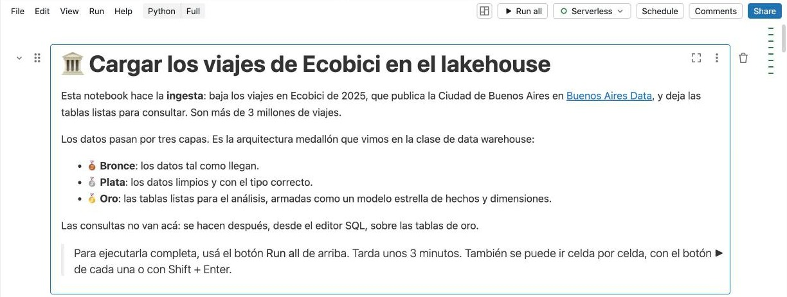

### Ejecutarla

Hacer clic en **Run all**, arriba a la derecha. Tarda unos 3 minutos y hace esto:

1. Crea el esquema `ecobici` en el catálogo `workspace` y, adentro, un **volumen**: una carpeta para guardar archivos tal como vienen.
2. Baja al volumen el archivo de 2025 de [Buenos Aires Data](https://data.buenosaires.gob.ar/dataset/bicicletas-publicas): un ZIP de unos 200 MB con un CSV de más de 800 MB.
3. Arma las tres capas de la **arquitectura medallón**:

| Capa | Qué guarda | Tablas |
| --- | --- | --- |
| Bronce | El CSV tal cual llegó, todo como texto, con sus problemas: duraciones escritas `1,016` e identificadores como `24503284BAEcobici` | `bronce_viajes` |
| Plata | Los mismos viajes limpios y con su tipo, sin los viajes que duraron más de un día | `plata_viajes` |
| Oro | Un modelo estrella para el análisis: una tabla de hechos con una fila por viaje y dos dimensiones | `hechos_viajes`, `dim_estacion`, `dim_fecha` |

Para un estadístico es lo de siempre: la base original, la base depurada y la base de análisis. La diferencia es que el lakehouse guarda las tres, así que la limpieza se puede rehacer sin volver a bajar nada.

La última celda cuenta las filas de cada tabla. Plata tiene 398 filas menos que bronce: son los viajes de más de un día, que son errores de registro.

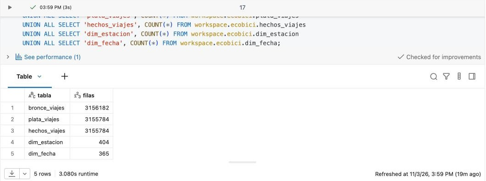

## 5. La consulta

### El catálogo

En la barra lateral, hacer clic en **Catalog** y abrir `workspace` y después `ecobici`. Están las cinco tablas y el volumen `archivos`, donde quedó el CSV original.

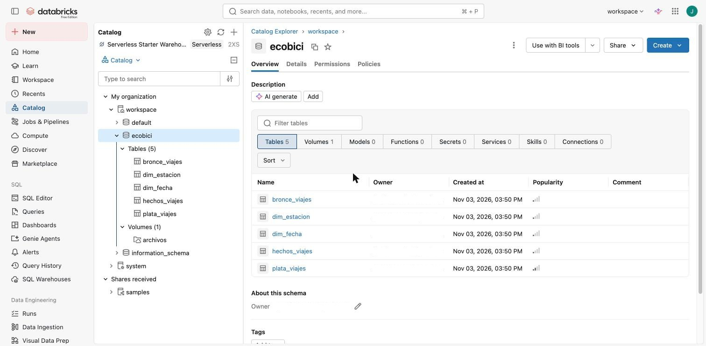

Al abrir `hechos_viajes` se ven sus columnas. Las que dicen **FK** son claves foráneas: la notebook declaró las claves primarias de las dimensiones y las foráneas de la tabla de hechos. En Databricks estas claves son informativas, porque no bloquean datos que no las cumplan, pero documentan el modelo. Con el botón **View relationships**, Databricks dibuja la estrella:

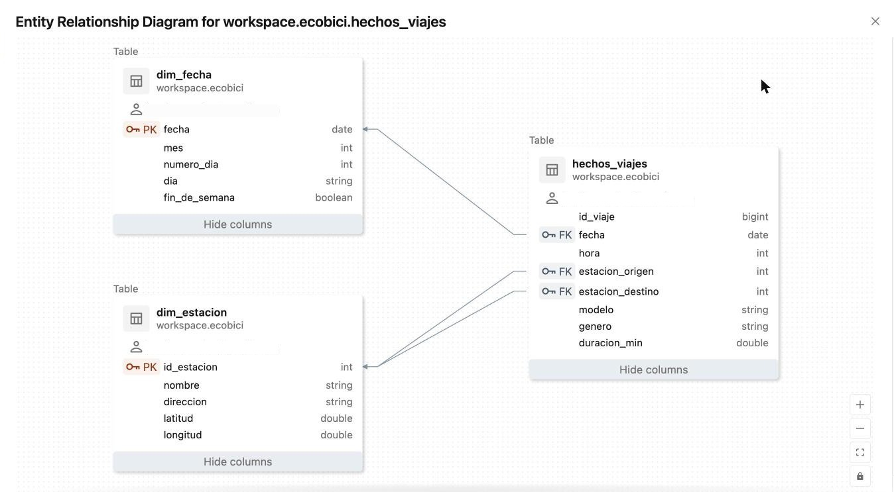

En la pestaña **Lineage**, el botón **See lineage graph** muestra de dónde sale cada tabla. Databricks lo anota solo, cada vez que una consulta crea una tabla a partir de otra: bronce, plata y oro, una detrás de la otra.

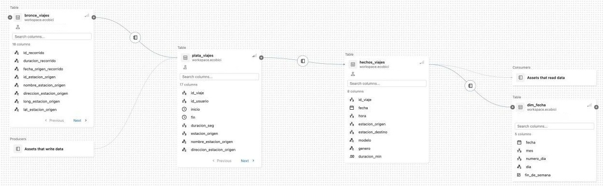

### El editor SQL

1. En la barra lateral, hacer clic en **SQL Editor**.
2. Arriba del editor, en el selector que dice `workspace.default`, elegir el esquema `ecobici`. Así las tablas se escriben con su nombre corto.
3. Escribir esta consulta, que une la tabla de hechos con la dimensión fecha y calcula cuántos viajes empiezan en cada hora, en promedio por día:

```sql
SELECT
  h.hora,
  IF(f.fin_de_semana, 'Fin de semana', 'Lunes a viernes') AS tipo_de_dia,
  ROUND(COUNT(*) / COUNT(DISTINCT h.fecha)) AS viajes_por_dia
FROM hechos_viajes h
JOIN dim_fecha f ON h.fecha = f.fecha
GROUP BY h.hora, tipo_de_dia
ORDER BY h.hora;
```

4. Hacer clic en **Run all**. La primera vez, Databricks pide prender el SQL Warehouse: hacer clic en **Start, attach and run**. Es el cómputo del que habla la sección 1.

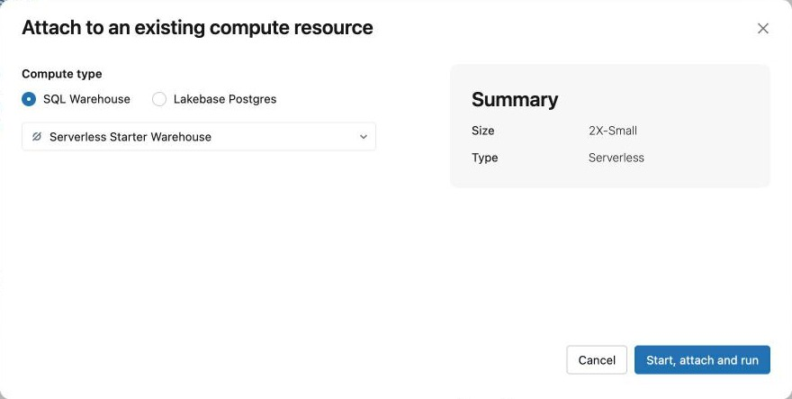

5. Para verlo como gráfico, hacer clic en el **+** que está al lado de **Table**, arriba del resultado. Se abre el editor de visualizaciones: cambiar el tipo a **Line**, con `hora` en **X column**, `viajes_por_dia` en **Y columns** y `tipo_de_dia` en **Group by**, y hacer clic en **Save**.

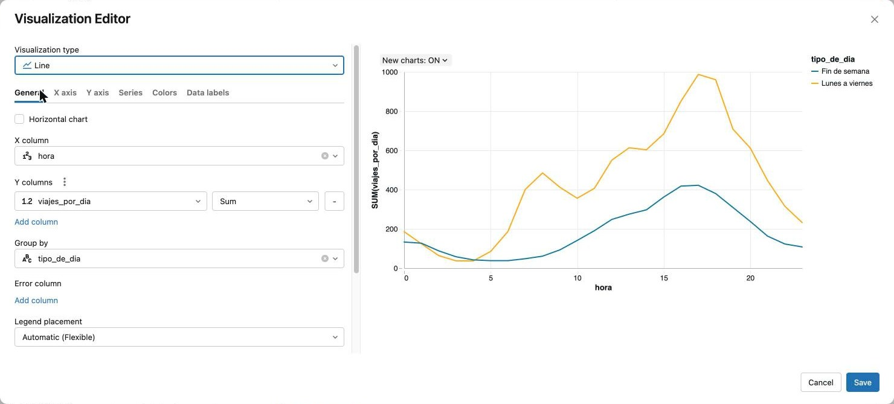

De lunes a viernes hay dos picos, a las 8 y a las 17: la ida y la vuelta del trabajo. El fin de semana, Ecobici se usa a la tarde.

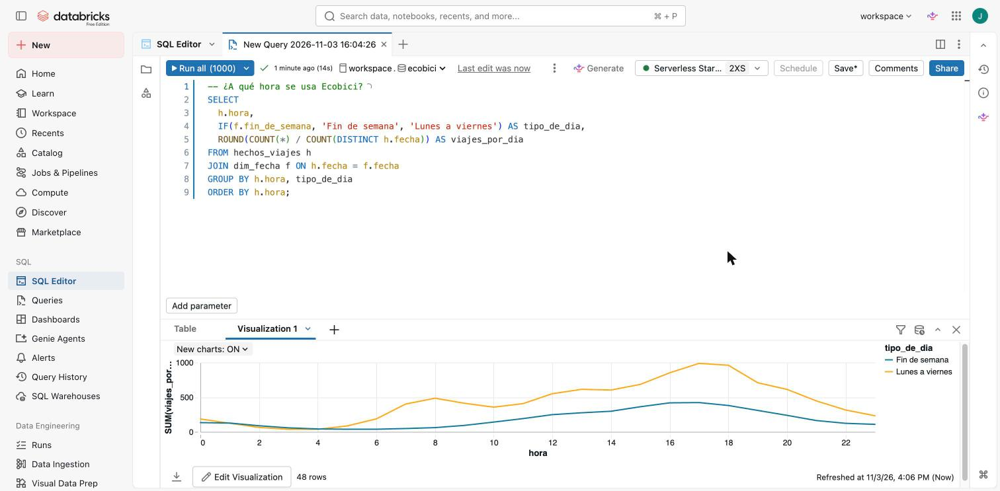

Para probar otra pregunta, esta consulta busca las diez estaciones donde empiezan más viajes. La primera es la estación 014 - Pacifico, con más de 32 mil viajes en el año.

```sql
SELECT e.nombre, COUNT(*) AS viajes
FROM hechos_viajes h
JOIN dim_estacion e ON h.estacion_origen = e.id_estacion
GROUP BY e.nombre
ORDER BY viajes DESC
LIMIT 10;
```

### El historial de versiones

Cada cambio en una tabla Delta crea una versión nueva, y las anteriores se conservan. Para verlo, simulemos un error en la tabla de plata. En una consulta nueva del editor, con el esquema `ecobici` elegido, escribir:

```sql
-- 1. El error: borramos sin querer todos los viajes de enero
DELETE FROM plata_viajes WHERE MONTH(inicio) = 1;

-- 2. Cuántos viajes hay ahora y cuántos había antes del error
SELECT 'Ahora' AS momento, COUNT(*) AS viajes FROM plata_viajes
UNION ALL
SELECT 'Antes del error', COUNT(*) FROM plata_viajes VERSION AS OF 0;
```

`VERSION AS OF 0` consulta la tabla como estaba en la versión 0, cuando se creó. Si la notebook se ejecutó más de una vez, la versión anterior al error tiene otro número: se busca en la pestaña **History** de la tabla, en el catálogo. En las capturas es la 3.

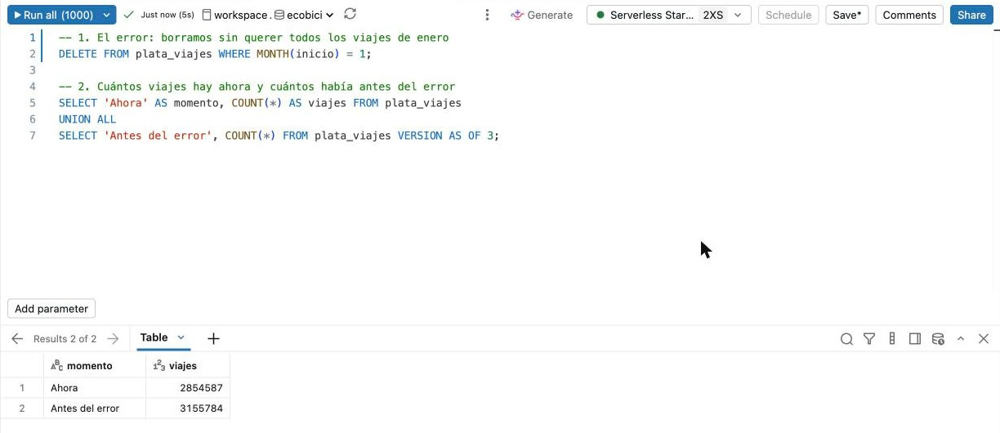

En **Catalog**, la pestaña **History** de `plata_viajes` muestra cada cambio con su número de versión, la fecha y la operación. El DELETE quedó registrado como una versión más:

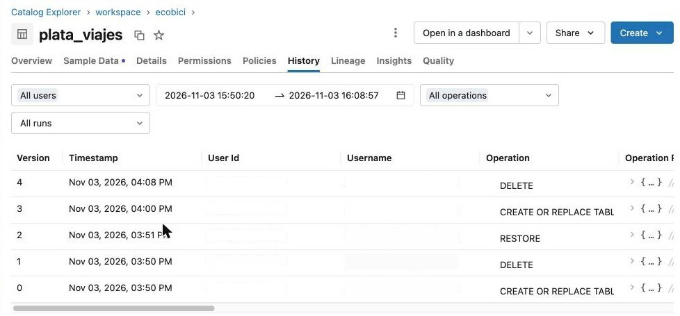

Para deshacer el error, `RESTORE` vuelve la tabla a la versión anterior. No borra el DELETE del historial: agrega una versión nueva, igual a la anterior al error.

```sql
-- 3. Volver a la versión anterior al error
RESTORE TABLE plata_viajes TO VERSION AS OF 0;
SELECT COUNT(*) AS viajes FROM plata_viajes;
```

Para ejecutar un solo paso, se seleccionan sus líneas y se hace clic en **Run selected**.

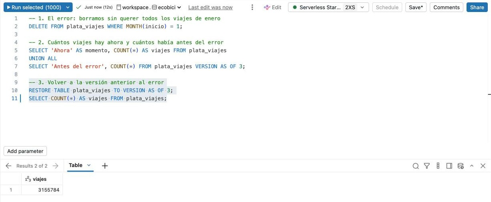

### Un tablero

Un tablero junta varios gráficos en una página. Se arma a partir de las consultas:

1. En la consulta de los viajes por hora, abrir el menú **⋮**, elegir **File** y después **Add to dashboard**.
2. Elegir **Create new dashboard**, escribir un nombre, por ejemplo "Tablero de Ecobici", y hacer clic en **Create**. El tablero se abre con el gráfico de líneas.
3. Para sumar un mapa, en la pestaña **Data** del tablero hacer clic en **Add SQL dataset** y escribir la consulta de abajo, que trae cada estación con su ubicación y sus viajes.
4. Volver a la página del tablero, agregar una visualización con el botón de la barra de abajo y elegir **Point map**, con `longitud`, `latitud` y `viajes`. También se le puede pedir a **Genie Code**, el asistente de Databricks, en castellano: "Mapa de estaciones por número de viajes con latitud y longitud".

```sql
SELECT e.nombre, e.latitud, e.longitud, COUNT(*) AS viajes
FROM workspace.ecobici.hechos_viajes h
JOIN workspace.ecobici.dim_estacion e ON h.estacion_origen = e.id_estacion
GROUP BY e.nombre, e.latitud, e.longitud;
```

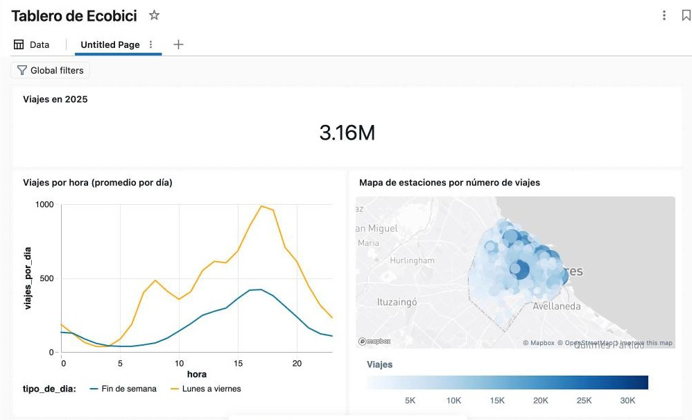

Todo lo que armamos queda guardado en la carpeta personal del **Workspace**: la notebook, las consultas y el tablero.

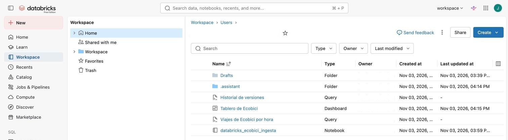

## 6. Para llevarse

- Un lakehouse guarda los datos en archivos abiertos y les suma tablas, tipos, transacciones e historial. Una tabla Delta es un conjunto de archivos Parquet más un registro de cambios.
- La arquitectura medallón separa los datos en capas: bronce para lo que llega, plata para lo limpio y oro para el análisis.
- El modelo estrella sigue siendo la forma de organizar los datos para el análisis, en un data warehouse o en un lakehouse.
- Databricks separa los datos del cómputo, igual que BigQuery. Con un archivo Parquet en la computadora, en cambio, los datos y el cómputo están en el mismo lugar.
- La ingesta y la consulta son momentos distintos, con herramientas y cómputo distintos.
