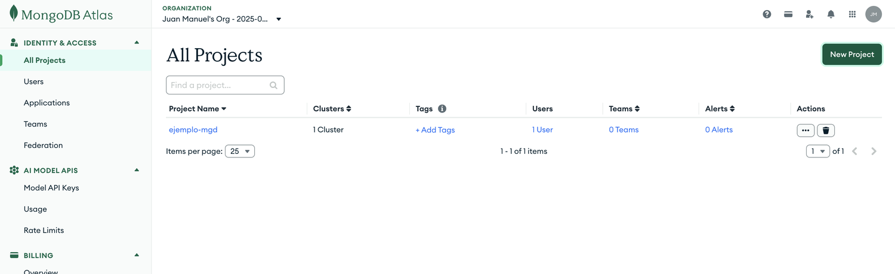
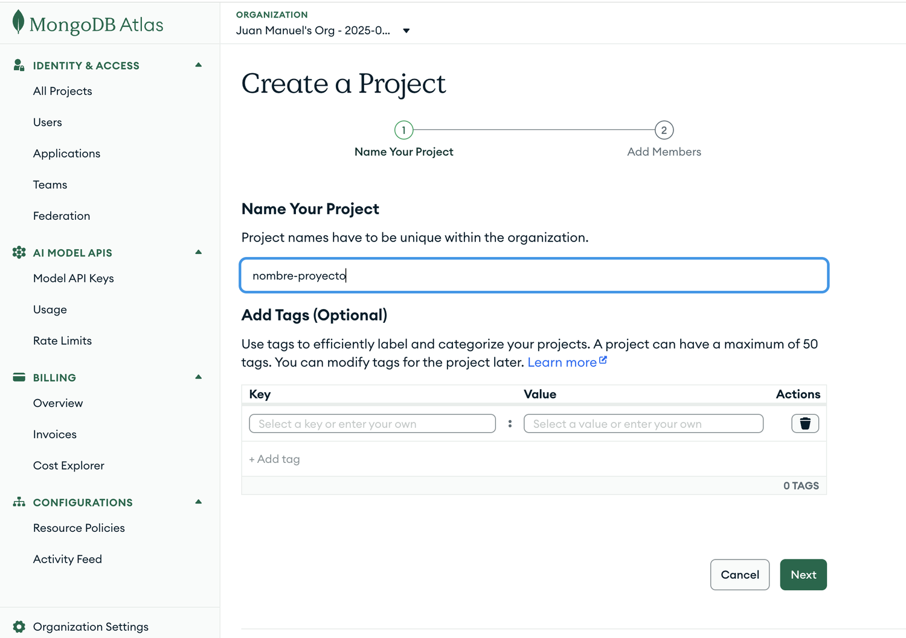
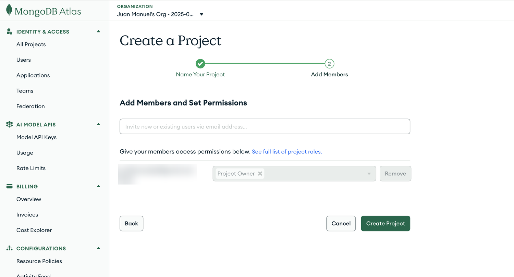
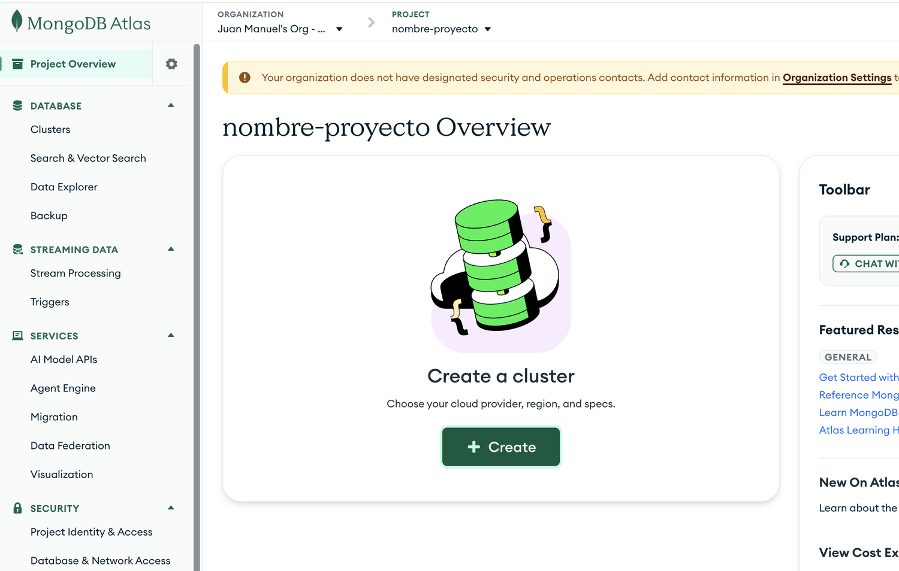
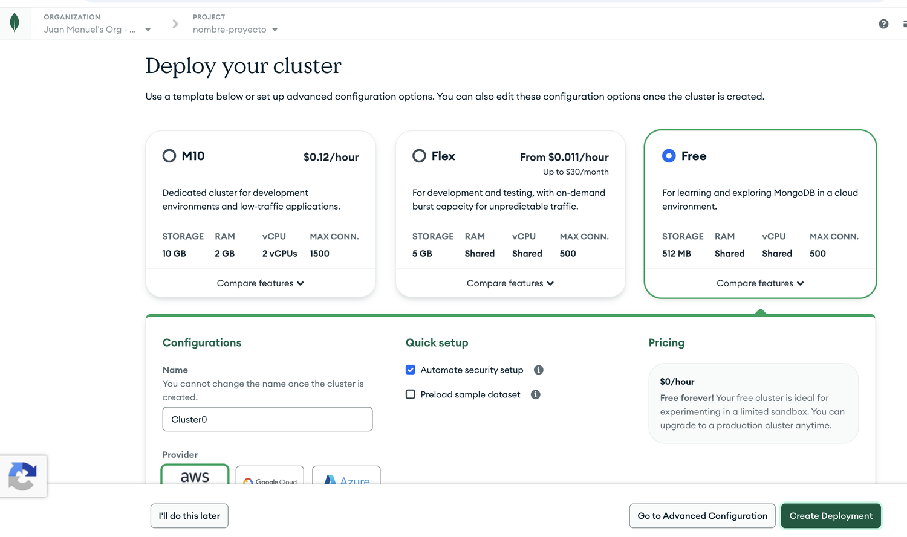
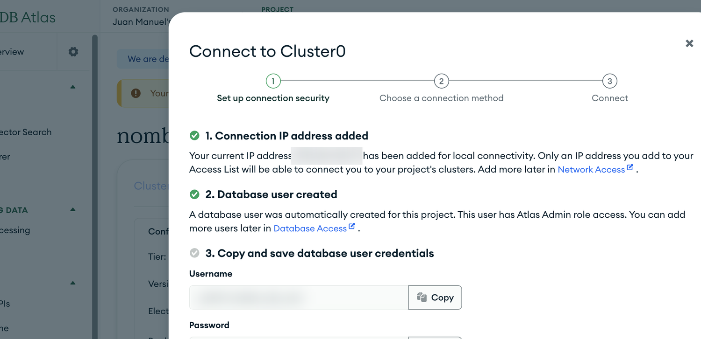
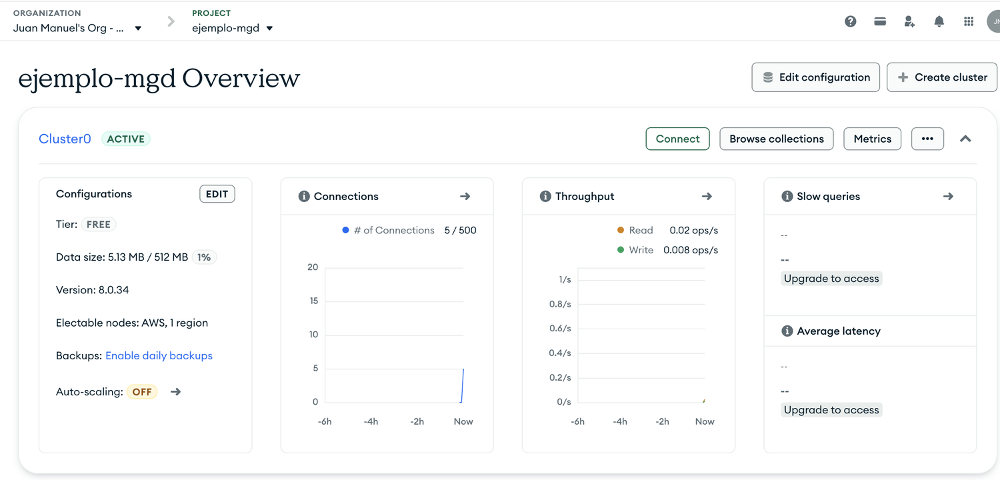

# Un cluster gratuito en MongoDB Atlas

MongoDB Atlas es el servicio oficial de MongoDB en la nube. Su plan **Free** (antes llamado M0) tiene 512 MB de almacenamiento, no vence y alcanza de sobra para el curso. Es la alternativa a instalar el servidor en la computadora: con un cluster en Atlas y Compass se puede seguir toda la guía [Primeros pasos con MongoDB Compass](MongoDB-Introducción.md).

Atlas permite un solo cluster Free por proyecto, así que conviene crear un proyecto para el curso.

## Crear un proyecto

1. Crear una cuenta en [MongoDB Atlas](https://www.mongodb.com/cloud/atlas/register). Se puede usar la cuenta de Google.
2. En **All Projects**, hacer clic en **New Project**.



3. Escribir un nombre para el proyecto, por ejemplo `mgd-untref`, y hacer clic en **Next**.



4. En **Add Members** no hace falta sumar a nadie. Hacer clic en **Create Project**.



Al crear la cuenta, Atlas puede abrir directamente la pantalla **Deploy your cluster**. Si ahí aparece la opción **Free**, se sigue desde el paso 2 de la sección siguiente. Si no aparece, hacer clic en **I'll do this later** y crear un proyecto nuevo como se muestra arriba.

## Crear el cluster Free

1. En la página del proyecto, hacer clic en **Create**.



2. En **Deploy your cluster**, elegir la opción **Free**. Las otras dos, M10 y Flex, son pagas: antes de seguir, verificar que en **Pricing** diga **$0/hour**.
3. Dejar el nombre `Cluster0`, que no se puede cambiar después, y el proveedor que viene marcado. En la región, elegir la más cercana entre las que ofrece.
4. Dejar marcada la opción **Automate security setup**: Atlas habilita la dirección IP de tu conexión y crea un usuario para la base. **Preload sample dataset** carga datos de ejemplo de MongoDB y no hace falta, porque vamos a importar los de la EPH.
5. Hacer clic en **Create Deployment**.



## Guardar el usuario y la contraseña

Al terminar, Atlas abre el diálogo **Connect to Cluster0** con el resumen de seguridad:

- Agregó tu dirección IP actual a la lista de acceso. Solo las direcciones de esa lista pueden conectarse; si después te conectás desde otra red, hay que sumarla en **Network Access**, dentro de *Database & Network Access* en el menú del proyecto.
- Creó un usuario de base de datos con permisos de administrador.
- Muestra el usuario y la contraseña, cada uno con su botón **Copy**. **Hay que copiarlos y guardarlos en este momento**, por ejemplo en un gestor de contraseñas: Atlas no vuelve a mostrar la contraseña. Si se pierde, se genera una nueva desde **Database Access**.



## Conectarse desde Compass

1. En el mismo diálogo, avanzar a **Choose a connection method** y elegir **Compass**.
2. Atlas muestra una cadena de conexión que empieza con `mongodb+srv://`. Copiarla y reemplazar `<db_password>` por la contraseña del usuario, sin los signos `<` y `>`.
3. En Compass, hacer clic en **Add New Connection**, pegar la cadena en el campo de la URI en lugar de `mongodb://localhost:27017` y hacer clic en **Save & Connect**.

La contraseña que genera Atlas no tiene símbolos. Si la cambiás por una propia, evitá caracteres como `@`, `:` o `/`, que rompen la cadena de conexión.

## Cargar los datos de la EPH

Con Compass conectado a Atlas, la carga es la misma que en la computadora:

1. Descargar el archivo [eph_hogares_2026t1.json](../data/eph_hogares_2026t1.json) con el botón *Download raw file*.
2. En el panel izquierdo de Compass, hacer clic en el **+** junto al nombre de la conexión de Atlas. Escribir `eph` como nombre de la base y `hogares` como nombre de la colección, y hacer clic en **Create Database**.
3. Abrir la colección `hogares`, desplegar **Add Data** y elegir **Import JSON or CSV file**.
4. Seleccionar el archivo descargado y hacer clic en **Import**. Como los datos viajan por internet hasta el cluster, tarda un poco más que en la computadora.

Al terminar, la colección tiene 15.447 documentos. En la página del proyecto en Atlas, **Data size** muestra cuánto ocupa la base: unos 5 MB de los 512 MB del plan Free.



Desde ahí, las consultas y agregaciones de la guía [Primeros pasos con MongoDB Compass](MongoDB-Introducción.md) funcionan igual. Atlas también permite ver los documentos desde el navegador, con el botón **Browse collections** del cluster.

## Crear usuarios y habilitar direcciones

Atlas controla quién entra al cluster con dos listas: los **usuarios de la base**, cada uno con su contraseña y sus permisos, y las **direcciones IP** habilitadas. El usuario que creó Atlas al principio es administrador. Para compartir la base con otras personas conviene crear usuarios aparte, con los permisos que cada uno necesita y nada más: es el principio de mínimo privilegio. Así está armada la base del curso, con el usuario `alumno`.

Para crear un usuario:

1. En el menú del proyecto, entrar a *Database & Network Access* y, en **Database Access**, hacer clic en **Add New Database User**.
2. Dejar el método **Password** y escribir el nombre del usuario y una contraseña, o generar una con **Autogenerate Secure Password**.
3. En **Built-in Role**, elegir los permisos: **Atlas admin** (administra todo), **Read and write to any database** (lee y modifica los datos) u **Only read any database** (solo lee). Con **Specific Privileges** se pueden limitar los permisos a una sola base.
4. Hacer clic en **Add User**.

Para habilitar direcciones, en **Network Access** se hace clic en **Add IP Address** y, en **Access List Entry**, se escribe la dirección que se quiere habilitar. La entrada `0.0.0.0/0` habilita cualquier dirección: hace falta para conectarse desde Google Colab, que cambia de IP en cada sesión. En **Comment** conviene anotar para qué es cada entrada y, si la opción de entrada temporal queda apagada, la dirección no vence. A partir de ahí, lo que protege el cluster son los usuarios y sus contraseñas.

## Desde R y Python

La misma cadena de conexión reemplaza a `mongodb://localhost:27017` en mongolite y en pymongo:

```r
hogares <- mongo(collection = "hogares", db = "eph", url = "mongodb+srv://...")
```

```python
cliente = MongoClient("mongodb+srv://...")
```

Como incluye la contraseña, la cadena de conexión no se comparte ni se deja escrita en un notebook que se publica.
