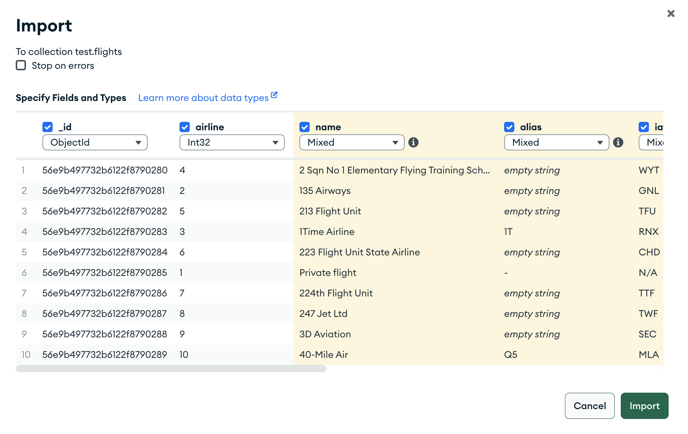
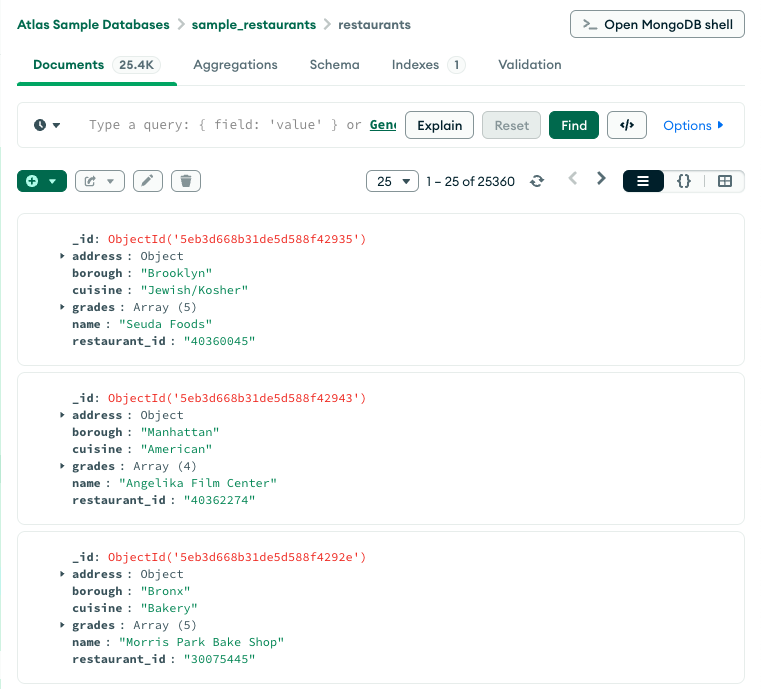
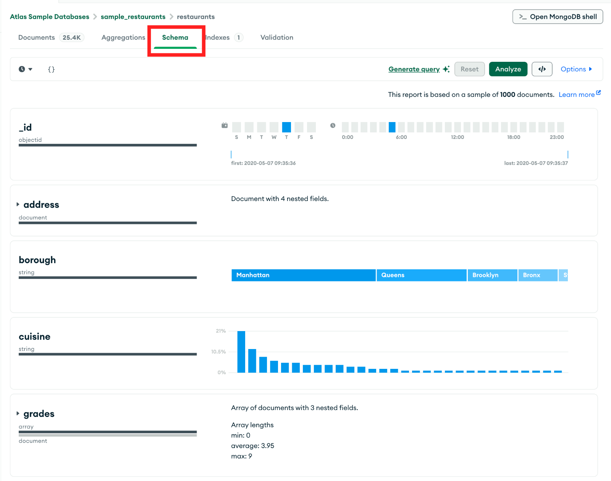
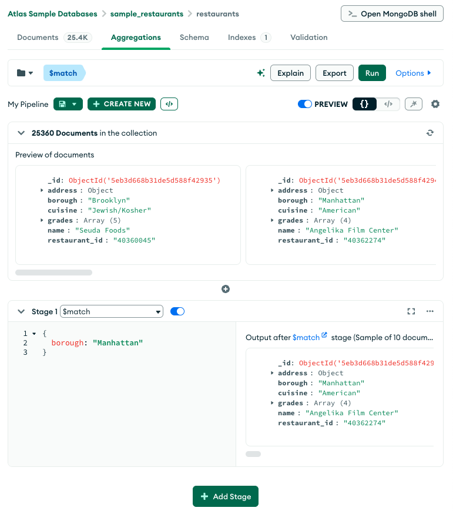

# Primeros pasos con MongoDB Compass

En esta guía creamos una base en MongoDB, importamos datos reales y los consultamos con **MongoDB Compass**, la interfaz gráfica oficial. La instalación está en la [guía de instalación](MongoDB-Instalación.md).

Trabajamos con la Encuesta Permanente de Hogares (INDEC) en formato documento: cada documento es un hogar del primer trimestre de 2026 y lleva embebidas a sus personas, como en el modelo que vimos en clase.

## Los datos

El archivo [eph_hogares_2026t1.zip](../data/eph_hogares_2026t1.zip) tiene 15.447 hogares con 43.739 personas. Hay que descomprimirlo: adentro está `eph_hogares_2026t1.json`, con un documento por línea. Así se ve un hogar de Gran Rosario:

```json
{
  "codusu": "TQRMNOQWTHMOMMCDEFKID00881844",
  "anio": 2026, "trimestre": 1, "nro_hogar": 1,
  "aglomerado": "Gran Rosario", "region": "Pampeana",
  "tenencia": "Está en sucesión",
  "itf": 3300000, "pondera": 742, "pondih": 1005,
  "personas": [
    { "componente": 1, "parentesco": "Jefe/a", "sexo": "Varón", "edad": 61,
      "nivel_educativo": "Primario completo", "estado": "Ocupado" },
    { "componente": 2, "parentesco": "Cónyuge/Pareja", "sexo": "Mujer", "edad": 60,
      "nivel_educativo": "Superior universitario incompleto", "estado": "Inactivo" },
    { "componente": 3, "parentesco": "Hijo/Hijastro/a", "sexo": "Varón", "edad": 31,
      "nivel_educativo": "Secundario incompleto", "estado": "Ocupado" }
  ]
}
```

- `itf` es el ingreso total familiar y `pondera`, el ponderador del hogar. Para los ingresos, INDEC indica usar `pondih`.
- Los hogares que no respondieron los ingresos no tienen el campo `itf`. En un esquema flexible, el dato que falta directamente no está.
- `estado` es la condición de actividad: *Ocupado*, *Desocupado*, *Inactivo*, *Menor de 10 años* o *Entrevista individual no realizada*.

## Crear la base e importar los datos

1. En Compass, conectarse al servidor local (`mongodb://localhost:27017`).
2. En el panel izquierdo, hacer clic en el **+** junto al nombre de la conexión. En el diálogo, escribir `eph` como nombre de la base y `hogares` como nombre de la colección, y hacer clic en **Create Database**. Compass pide crear la base junto con su primera colección.
3. Abrir la colección `hogares`, desplegar **Add Data** y elegir **Import JSON or CSV file**.
4. Seleccionar `eph_hogares_2026t1.json` y hacer clic en **Import**.

Al terminar, la colección tiene 15.447 documentos. El mismo diálogo importa archivos CSV: antes de importar permite elegir qué columnas entran y el tipo de dato de cada una.



## Explorar los documentos

La pestaña **Documents** muestra los documentos de la colección, en vista de lista, JSON o tabla. La barra de consulta recibe un filtro con el mismo formato que `find()`: se ejecuta con **Find** y se limpia con **Reset**. En **Options** se agregan la proyección (*Project*), el orden (*Sort*) y el límite (*Limit*).



Para probar en la barra de consulta:

| Pregunta | Filtro | Resultado |
|---|---|---|
| Hogares de Cuyo | `{ region: "Cuyo" }` | 1.412 |
| Hogares con ingreso total familiar mayor a un millón | `{ itf: { $gt: 1000000 } }` | 7.713 |
| Hogares de Cuyo o del Noreste | `{ region: { $in: ["Cuyo", "Noreste"] } }` | 2.920 |

Para ver solo el código y el ingreso, de mayor a menor, el filtro queda vacío (`{}`) y en **Options** se completan *Project* con `{ codusu: 1, itf: 1 }` y *Sort* con `{ itf: -1 }`.

## Analizar el esquema

La pestaña **Schema**, con el botón **Analyze**, toma una muestra de documentos y resume cada campo: tipos de dato, valores frecuentes y distribución. Funciona como un primer análisis exploratorio. En esta colección muestra, por ejemplo, que `itf` falta en alrededor de un cuarto de los hogares y que `personas` es un array de documentos.



## Operaciones CRUD en la consola

El botón **Open MongoDB shell** abre la consola `mongosh` dentro de Compass. Ahí se escriben los mismos comandos que en clase. Para no modificar los datos de la EPH, practicamos las operaciones CRUD en una colección nueva, `noticias`, que MongoDB crea con la primera inserción:

```javascript
use eph

// Create: un documento y después varios
db.noticias.insertOne({
  _id: 1,
  titulo: "Se estrelló un avión en Cuba",
  cuerpo: "La aeronave cayó a poco de despegar del aeropuerto de La Habana.",
  fecha: "2018-05-18"
})
db.noticias.insertMany([
  { _id: 2, titulo: "Sube el dólar", fecha: "2018-05-14" },
  { _id: 3, titulo: "Paro de transporte", fecha: "2018-05-15" }
])

// Read
db.noticias.find()
db.noticias.find({ fecha: { $gte: "2018-05-15" } })

// Update: modifica el primer documento que cumple el filtro
db.noticias.updateOne({ _id: 1 }, { $set: { titulo: "Noticia modificada" } })

// Delete
db.noticias.deleteOne({ _id: 3 })
```

`updateMany()` y `deleteMany()` hacen lo mismo con todos los documentos que cumplen el filtro.

## Consultas sobre documentos anidados

La notación de punto llega a los campos de las personas. Una condición sobre un array se cumple si algún elemento la cumple; con `$elemMatch`, un mismo elemento tiene que cumplir todas las condiciones:

```javascript
// Hogares con al menos una persona de 65 años o más: 4.833
db.hogares.countDocuments({ "personas.edad": { $gte: 65 } })

// Hogares con alguna mujer desocupada: 639
db.hogares.countDocuments({
  personas: { $elemMatch: { sexo: "Mujer", estado: "Desocupado" } }
})

// Sin $elemMatch: 1.187
db.hogares.countDocuments({ "personas.sexo": "Mujer", "personas.estado": "Desocupado" })
```

La última consulta cuenta de más: incluye, por ejemplo, hogares con una mujer ocupada y un varón desocupado.

## Agregaciones

La pestaña **Aggregations** arma el pipeline etapa por etapa con **Add Stage** y muestra el resultado de cada una. Este pipeline estima la población de cada región según su condición de actividad:

```javascript
db.hogares.aggregate([
  { $unwind: "$personas" },
  { $group: {
      _id: { region: "$region", estado: "$personas.estado" },
      poblacion: { $sum: "$pondera" }
  } },
  { $sort: { "_id.region": 1, poblacion: -1 } }
])
```

Para Gran Buenos Aires da 7.269.425 ocupados y 691.244 desocupados: una tasa de desocupación de 8,7%, la misma que se obtiene con SQL sobre la base relacional del cuaderno [De la EPH a PostgreSQL](https://jumafernandez.github.io/modelado-gestion-datos-untref/guias/cuaderno-eph/).



El botón `</>` (*Export to Language*) traduce el pipeline a código de Python, Java, C# y otros lenguajes. Los resultados de una consulta se exportan a CSV o JSON desde **Export Data**, y los de una agregación, desde **Export**, para seguir el análisis en R.

## Desde la terminal

Para importar el mismo archivo sin Compass:

```bash
mongoimport --db eph --collection hogares --file eph_hogares_2026t1.json
```

Los comandos de respaldo y restauración están en la [guía de instalación](MongoDB-Instalación.md). Para trabajar con MongoDB desde R, ver la guía [MongoDB desde R](MongoDB-desdeR.md).
